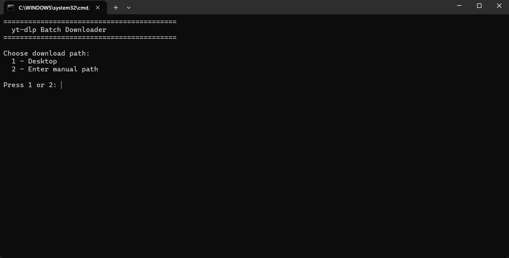

<h1 align="center">yt-dlp Batch Downloader</h1>

<b>A tiny Windows menu around yt-dlp for downloading videos one URL at a time</b>

  
  
  
  

---

## Overview
A Windows batch script that asks for a download folder and then repeatedly asks for video URLs and downloads each one with yt-dlp using the best available format and an optional cookies file.

## Features
- Choose Desktop or a custom folder
- Loop: paste a URL, download, repeat
- Uses a cookies file for sites that require login
- Clear success / error message after every download
- Loops until you press Enter on an empty URL
- Names files from the video title automatically

## How it works
- The script reads the paths set at the top (YTDLP and COOKIES).
- You choose a destination folder, then paste a URL.
- It runs yt-dlp --cookies ... -f best -o and reports success or errors, then asks for the next URL.

## Requirements
- Windows 10/11.
- yt-dlp.exe from the official project (and ffmpeg for formats that need merging).
- Optional cookies.txt exported from your own browser session.

## Screenshots

## Download and install
### Option A - Download
No prebuilt binary is published for this project. Use Option B below.

### Option B - Run the script
Download the script from this repository and run it as described in **How to use**.

## How to use
1. Download **yt-dlp.exe** from https://github.com/yt-dlp/yt-dlp/releases and save it as C:\yt-dlp.exe (or edit the YTDLP line in the script).
2. Optional: export your own browser cookies to C:\cookies.txt (or edit the COOKIES line).
3. Run download_enarsi.bat, choose the download path, then paste a video URL.
4. Leave the URL empty to exit.

## Configuration and privacy
- No cookies, tokens or accounts are included; create your own cookies file locally and never commit it.

## Troubleshooting
- Script cannot find yt-dlp: fix the YTDLP path at the top.
- Login-only video fails: refresh your cookies file; cookies expire.
- Merging error: install ffmpeg and put it in PATH.

## Notes
- Download only content you have the right to save, and follow the terms of the website.

---

Maintained by <a href="https://github.com/alisadhk">@alisadhk</a> - last update 2025-09-30
